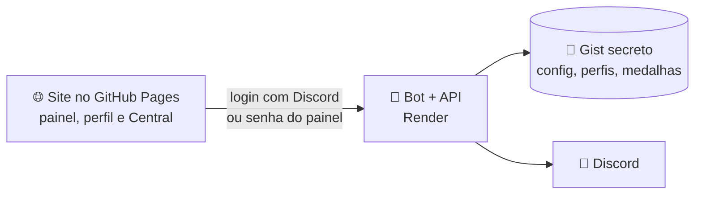

<div align="center">


# 🌧️ Manda Chuva

### O bot oficial da resenha

Cargos de cor, boas-vindas com card, festas que se trocam sozinhas, aniversários, tickets, moderação e perfil com medalhas.<br>
Tudo configurado por um painel bonito no navegador, com login do Discord.

[](https://pedroa07.github.io/Interface-Manda-Chuva-Bot/painel.html)
[](https://manda-chuva-bot.onrender.com/saude)
[](https://discord.js.org)
[](https://nodejs.org)
[](#)

**[➕ Adicionar ao Discord](https://discord.com/api/oauth2/authorize?client_id=1566518074587349042&scope=bot+applications.commands&permissions=1099780189366)** &nbsp;·&nbsp;
**[🖥️ Abrir o painel](https://pedroa07.github.io/Interface-Manda-Chuva-Bot/painel.html)** &nbsp;·&nbsp;
**[🌐 Site](https://pedroa07.github.io/Interface-Manda-Chuva-Bot/)** &nbsp;·&nbsp;
**[📘 Central do Bot](https://pedroa07.github.io/Interface-Manda-Chuva-Bot/central.html)**

</div>

---

## ✨ O que ele faz

<table>
<tr>
<td width="50%" valign="top">
<br>
<h3>🎨 Cargos de cor</h3>
Até 24 cores com emoji, degradê e botão no painel. Clicou, pintou o nome. Clicou de novo, tirou. Também tem <code>/cor</code>.
</td>
<td width="50%" valign="top">
<br>
<h3>🚪 Portaria</h3>
Boas-vindas com <b>card desenhado na hora</b> com a foto e o nome de quem chegou, cargo automático e mensagens de saída, expulsão, ban e silêncio.
</td>
</tr>
<tr>
<td valign="top">
<br>
<h3>🎉 Festas automáticas</h3>
Natal, Ano Novo, Carnaval, Páscoa, Junina, Halloween e mais: o bot troca banners, cores e frases sozinho na data certa.
</td>
<td valign="top">
<br>
<h3>🎂 Aniversários</h3>
Cada um cadastra com <code>/aniversario</code>. No dia sai o card com foto e idade, o cargo "Aniversariante do dia" e parabéns na DM.
</td>
</tr>
<tr>
<td valign="top">
<br>
<h3>🎫 Tickets</h3>
Menu de motivos, canal privado com a staff, fila, transcrição em <code>.html</code>, avaliação por estrelas e canal que some sozinho.
</td>
<td valign="top">
<br>
<h3>🪪 Perfil e medalhas</h3>
Login com o Discord no site: 48 banners, bio e 16 medalhas pra colecionar falando, aparecendo na call e indo nos eventos.
</td>
</tr>
<tr>
<td valign="top">
<br>
<h3>🛡️ Moderação</h3>
Avisos que expiram, silenciar (até sem prazo), expulsar, livro de ocorrências com Desfazer e auto-mod com a AutoMod do Discord.
</td>
<td valign="top">
<br>
<h3>📰 Jornal do Campus</h3>
Toda versão nova vira notícia no painel e, se você quiser, num canal do servidor. Ninguém fica sem saber o que mudou.
</td>
</tr>
</table>

## 🏅 Medalhas do campus

<div align="center">


</div>

## ⌨️ Comandos

| Comando | O que faz | Quem usa |
|---|---|---|
| `/cor` | Escolhe (ou tira) a cor do seu nome | 🟢 todos |
| `/aniversario cadastrar dia mes [ano]` · `ver [@membro]` · `apagar` | Cadastra, mostra (em imagem, do jeito que a pessoa deixou ver) ou apaga o aniversário | 🟢 todos |
| `/perfil [@membro] [completo]` | Mostra a carteirinha em imagem (GIF se o banner ou a foto for animado); com `completo`, vem aniversário e troféus | 🟢 todos |
| `/trofeus [@membro]` | Os troféus (medalhas ganhas) em imagem | 🟢 todos |
| `/favoritos [@membro]` | Jogos, filmes, livros e músicas favoritos, com capa, em imagem | 🟢 todos |
| `/regras` | Mostra as regras do servidor só pra você (depois que a staff publica) | 🟢 todos |
| `/medalhas` | Lista suas medalhas e o que falta pra cada uma | 🟢 todos |
| `/painel` | Cartão com os botões pro painel e pra Central | 🟢 todos |
| `/ticket abrir` · `fechar` | Abre ou fecha um ticket com a staff | 🟢 todos |
| `/privacidade ver` · `apagar` | Mostra ou apaga os seus dados | 🟢 todos |
| `/ticket add` · `remover` · `assumir` · `renomear` | Cuida do ticket atual | 🔵 staff |
| `/medalha @membro medalha` | Dá (ou tira) medalha de evento | 🔵 staff |
| `/tema simular <festa>` | Prévia de uma festa antes da data | 🔵 staff |
| `/ticket painel` · `config` | Manda o menu de tickets e o link da configuração | 🔴 admin |

## 💬 Textos prontos pro Discord

Apresentação do bot, temporada de medalhas e como funciona o ticket, já formatados pro Discord e cabendo numa mensagem: **[docs/APRESENTACAO-DISCORD.md](docs/APRESENTACAO-DISCORD.md)**.

## 🖥️ O painel

<table>
<tr>
<td width="50%"></td>
<td width="50%"></td>
</tr>
<tr>
<td align="center"><b>Staff</b>: cores, cargos, painel, portaria, temas, tickets</td>
<td align="center"><b>Membros</b>: notícias, a turma e o próprio perfil</td>
</tr>
</table>

O site fica em outro repositório: **[Interface-Manda-Chuva-Bot](https://github.com/PedroA07/Interface-Manda-Chuva-Bot)**. Este aqui é o bot + a API que o site usa.



---

## 🛠️ Hospedar o seu

<details>
<summary><b>1️⃣ Criar o bot no Discord</b></summary>

1. Abra https://discord.com/developers/applications → **New Application** → dê o nome (ex.: Manda Chuva).
2. Aba **Bot** → **Reset Token** → copie o token. Guarde: ele é a senha do bot.
3. Na mesma aba, ligue **Server Members Intent** (o painel usa pra contar quem tem cada cor; a portaria e a moderação também vão usar) e **Message Content Intent** (o texto das mensagens na transcrição dos tickets). Sem elas o bot funciona, só sem essas partes: ele avisa no terminal e no painel.

</details>

<details>
<summary><b>2️⃣ Testar no seu PC (opcional)</b></summary>

Precisa do Node 22 ou mais novo.

```
copy .env.example .env      (e cole o token em DISCORD_TOKEN)
npm install
npm start
```

Sem `PAINEL_SENHA`, a API só aceita acesso do próprio PC. Abra a interface (veja o LEIA-ME dela) com o endereço `http://localhost:3000`. O link pra adicionar o bot a um servidor aparece no terminal e na interface.

</details>

<details>
<summary><b>3️⃣ Subir na Render (grátis) e ligar o login com Discord</b></summary>

1. **Gist pra guardar a configuração.** A Render grátis apaga os arquivos sempre que reinicia, então a configuração fica num Gist secreto:
   - Crie em https://gist.github.com um gist **secreto** com um arquivo chamado `paineis.json` contendo `[]`. O ID é o código no fim do endereço (`gist.github.com/PedroA07/` **`este-código`**).
   - Crie um token só com a permissão de gist: [github.com/settings/tokens/new?scopes=gist](https://github.com/settings/tokens/new?scopes=gist&description=Manda-Chuva-BOT). Em "Expiration", escolha o prazo que preferir.
2. **Crie o serviço:** abra https://render.com/deploy?repo=https://github.com/PedroA07/Manda-Chuva-BOT (entre com o GitHub). A Render lê o `render.yaml` e pede:
   - `DISCORD_TOKEN`: o token do passo 1.
   - `PAINEL_SENHA`: uma senha forte, com 12 caracteres ou mais. É ela que a interface vai pedir.
   - `GIST_ID` e `GIST_TOKEN`: do item acima.
3. Espere o deploy terminar e copie o endereço do serviço (algo como `https://manda-chuva-bot.onrender.com`). Abrindo esse endereço no navegador deve aparecer `{"ok":true,"bot":"online"}`.
4. Abra a interface, coloque esse endereço e a senha.
5. **Login com Discord (pra membros e staff entrarem com a própria conta):**
   - No Developer Portal → sua aplicação → **OAuth2**: copie o **Client Secret** (Reset Secret) e, em **Redirects**, adicione `https://manda-chuva-bot.onrender.com/auth/callback` (o endereço do seu serviço + `/auth/callback`).
   - Na Render → o serviço → **Environment**: crie `DISCORD_CLIENT_SECRET` com o segredo copiado. Depois do deploy, o `/saude` mostra `"login":true` e o botão "Entrar com Discord" do site passa a funcionar.
   - Quem tem "Gerenciar servidor" entra como staff com tudo liberado; quem tem o cargo da staff (aba Tickets) entra como staff (menos a hierarquia de cargos); o resto vê Notícias, Membros e Meu perfil. A senha do painel continua valendo como antes.

O `render.yaml` já liga o `MANTER_ACORDADO=1`: o bot acessa o próprio endereço a cada 10 min, porque a Render grátis desliga o serviço depois de 15 min sem acesso (e aí o bot sai do Discord). O plano grátis dá 750 horas por mês, o que cobre um serviço ligado o mês todo.

</details>

<details>
<summary><b>⚙️ Variáveis de ambiente</b></summary>

| Variável | Pra quê |
|---|---|
| `DISCORD_TOKEN` | Token do bot. |
| `PAINEL_SENHA` | Senha da interface (mínimo 12 caracteres). Sem ela, a API só aceita acesso do próprio PC. |
| `DISCORD_CLIENT_SECRET` | Liga o "Entrar com Discord" no site (Developer Portal → OAuth2). Precisa do redirect `<endereço do bot>/auth/callback` cadastrado lá. |
| `SESSAO_SEGREDO` | Opcional: troque pra derrubar todas as sessões do site. |
| `PAINEL_ORIGENS` | Sites que podem usar a API, separados por vírgula. Já vem com `https://pedroa07.github.io`. Endereços `localhost` sempre podem. |
| `GIST_ID`, `GIST_TOKEN` | Guardam a configuração num Gist em vez da pasta `dados/`. |
| `MANTER_ACORDADO` | `1` = acessa o próprio endereço a cada 10 min. Usa `URL_PUBLICA` ou, na Render, o `RENDER_EXTERNAL_URL`. |
| `PAINEL_PORTA` | Porta da API no PC (padrão 3000). Na hospedagem vale a `PORT` que ela define. `0` desliga a API. |
| `SO_PAINEL` | `1` = esta cópia só serve a API e não responde aos botões (veja abaixo). |
| `URL_IMAGENS` | Onde ficam os banners da galeria (padrão: o site da interface no GitHub Pages). |
| `DADOS_PASTA` | Pasta da configuração quando não usa Gist (padrão: `dados/`). |

</details>

<details>
<summary><b>📚 Bom saber (como cada parte funciona)</b></summary>

- Não rode duas cópias normais com o mesmo token ao mesmo tempo, senão as duas respondem aos botões. Se o bot de verdade está na Render e você quer mexer pelo PC, use `SO_PAINEL=1` na cópia do PC.
- O bot **nunca** dá por botão um cargo com permissão de moderação/admin, nem cargo de bot.
- Cada botão guarda o ID do cargo, então painel antigo continua funcionando mesmo se a configuração se perder.
- Depois de salvar, confira o quadro **Hierarquia de cargos** na interface: o cargo do bot precisa ficar acima dos cargos de cor, e os cargos de cor acima dos outros cargos que têm cor.
- O Discord só tem 4 cores de botão (cinza, azul, verde e vermelho). Quem pinta o nome é o cargo. Com "cor do cargo" ou "cor própria", o bot põe uma bolinha da cor no botão (emoji da própria aplicação, não gasta os emojis do servidor) e usa o fundo mais parecido.
- As mensagens usam o layout novo do Discord: banner em cima, caixa colorida, imagens no final e botões. Imagem enviada pelo painel ("Anexar") fica guardada junto da configuração e vai como arquivo na mensagem.
- Degradê no nome precisa de servidor com impulso. Sem isso, o cargo fica com a primeira cor.
- **Portaria:** mensagens quando alguém entra (com um card desenhado pelo bot com a foto e o nome), sai, é expulso, banido ou silenciado. Entrou/saiu precisam da **Server Members Intent**. Expulsão, ban e silêncio vêm do registro de auditoria: o cargo do bot precisa de "Ver o registro de auditoria" (sem ela, expulsão aparece como "saiu"). "Testar comigo" manda a mensagem na DM de quem é dono do bot.
- **Aniversários:** cada membro cadastra o seu com `/aniversario cadastrar` preenchendo dia (DD), mês (MM) e ano (AAAA, opcional) em campos separados (`/aniversario apagar` tira; quem vê no perfil a pessoa escolhe em Meu perfil) ou pelo botão do painel de cores. No horário escolhido (horário de Brasília) o bot posta a mensagem com o card da pessoa, dá o cargo "Aniversariante do dia" por 24 horas (cria o cargo se não existir) e, se ligado, manda DM. Quem nasceu em 29/02 comemora em 28/02 nos anos comuns.
- **Hierarquia (aba Cargos):** a lista de cargos de cima pra baixo, com os cargos de cor num bloco só (na ordem da aba Cores). Dá pra subir/descer, criar separadores (`━━ NOME ━━`), criar, editar e apagar cargos. Tudo vai pro Discord no Salvar. O bot só mexe nos cargos abaixo do cargo mais alto dele e só dá as permissões que ele mesmo tem; cargos de integração (outros bots, impulso) só mudam de lugar.
- **Membros e moderação (aba Cargos):** busca de membros (sem a intent "Server Members", só pela busca), dar/tirar cargo, Avisar, Silenciar (10 min a 28 dias, ou sem prazo: o bot renova os 28 dias sozinho e silencia de novo quem sair e voltar) e Expulsar, que valem na hora. Avisos expiram em 30 dias; ao juntar N o bot silencia 1 hora e ao juntar M expulsa (0 = nunca). Tudo vai pro livro de ocorrências (com Desfazer pra aviso, silêncio e ban) e, se escolhido, pro canal de registros. Expulsões, bans e silêncios feitos no Discord por outras pessoas também entram no livro. Precisa das permissões Expulsar, Silenciar e Banir membros.
- **Auto-moderação (aba Cargos › Moderação):** palavrões (lista editável), convites de outros servidores, chuva de menções (mais de 5) e links suspeitos viram regras "Manda Chuva · …" na AutoMod do próprio Discord (funcionam com o bot dormindo; precisa de "Gerenciar servidor"). O anti-spam (5 mensagens em 3 s) é o bot que conta pelos eventos de mensagem, sem ler o texto (precisa de "Gerenciar mensagens"). Ações: só apagar, avisar, silenciar 10 min ou expulsar. Cargos de moderação ficam de fora.
- **Temas de datas festivas:** em cada data (Natal, Ano Novo, Carnaval, Páscoa...) o bot troca banner, miniatura, cor e põe a frase do tema nas mensagens marcadas em "Usar em". Quando dois temas caem no mesmo dia, ganha o de período menor. Carnaval e Páscoa são calculados todo ano. O dia é contado no horário de Brasília (`FUSO` troca). A cada 30 min o bot confere a data e atualiza os painéis já enviados.
- Banners "Eventos" da galeria: o bot desenha a placa com o nome do seu servidor (rota pública `/placas/<evento>.jpg`).
- **Tickets (aba Tickets):** o bot põe um menu de motivos no canal escolhido; quem escolhe ganha um canal privado `#ticket-0042-nome` na categoria (ou o bot cria a 🎫 TICKETS), com Assumir, Adicionar membro e Fechar. Ao fechar: transcrição `.html` no canal de logs e na DM, avaliação de 1 a 5 estrelas na DM e o canal some depois do prazo escolhido. Fecha sozinho ticket parado. Comandos `/ticket abrir, fechar, add, remover, assumir, renomear, painel, config`. Precisa de "Gerenciar canais"; sem a Message Content Intent a transcrição sai sem o texto.
- **Meu perfil e medalhas (site):** cada pessoa escolhe banner (do Discord, 48 da galeria, link ou anexo), foto (do Discord, link ou anexo), bio, até 3 medalhas fixadas, a aparência do cartão (cor do fundo, cor do nome sólida ou em degradê, 8 fontes e cor de destaque, que valem no site e nas imagens do bot) quem vê o aniversário (ninguém, só dia e mês, ou com a idade) e até 5 favoritos por lista (jogos, filmes, livros e músicas). A capa de cada favorito o bot procura só pelo nome na Steam, Wikipédia, Apple (iTunes) e Open Library, sem chave de API; não achou, entra uma arte da galeria. Anexo de membro fica no canal escondido `deposito-do-bot` (criado no primeiro envio; precisa de Gerenciar canais), e apagar uma mensagem lá tira a imagem do perfil. O bot conta mensagens (sem ler o texto), tempo em call, madrugada, trocas de cor e tempo de casa; medalhas de evento a staff dá com `/medalha` ou pela aba Cargos › Membros. Os números ficam em `estatisticas.json` e os perfis em `perfis.json` (Gist).
- **Comandos de todo mundo:** `/cor`, `/aniversario cadastrar|ver|apagar`, `/perfil [@membro] [completo]`, `/trofeus`, `/favoritos`, `/regras`, `/medalhas`, `/painel`, `/ticket abrir|fechar` e `/privacidade ver|apagar` (apaga aniversário, perfil e contadores). Da staff: `/ticket add|remover|assumir|renomear`, `/medalha` e `/tema simular`. A lista com quem pode usar cada um fica na Central do Bot (`central.html` no site).
- **Servidor (aba Servidor, só quem gerencia o servidor):** monta o servidor a partir de um modelo (Resenha + Jogos, Só resenha, Gamer raiz, Campus) com as categorias escolhidas: cria cargos (Reitor, Coordenação e Monitor com permissões de moderação, Verificado, cargos de jogo e de aviso), categorias e canais, reaproveitando o que já existe pelo nome (mesmo com fonte ou enfeite). Opções: fontes nos nomes, permissões (Portaria aberta e só leitura nos avisos, o resto só pra Verificado e staff, Staff só pra staff), botões de cargo de jogo no #escolha-sua-cor e apagar o que está fora do modelo (nunca apaga o que o bot usa, cargos de cor, separadores e integrações). Em "Fontes e nomes", cada alvo (categorias, canais, cargos) ganha fonte Unicode, enfeite e caixa, e "Renomear o que já existe" aplica tudo. A obra roda em segundo plano e o painel mostra o andamento.
- **Jornal do Campus:** a cada versão nova, o bot posta a notícia no canal escolhido na aba Notícias do painel (desligado até você escolher o canal). Na primeira vez ele posta só a mais recente. Pra mencionar @everyone, o cargo do bot precisa da permissão "Mencionar @everyone".
- `#000000` no Discord é "sem cor". Pra preto use `#010101`.
- Limites do Discord: até 24 cores, 40 peças e 4000 letras por mensagem (o painel avisa antes de salvar).
- Testes: `npm test`.
- Na Render grátis, o primeiro acesso depois de um tempo parado pode demorar cerca de 1 minuto.

</details>

---

<div align="center">


<sub>Feito com café do RU · EST. 2026 · <a href="https://pedroa07.github.io/Interface-Manda-Chuva-Bot/central.html#termos">Termos de Uso</a> · <a href="https://pedroa07.github.io/Interface-Manda-Chuva-Bot/central.html#privacidade">Privacidade</a> · <a href="https://pedroa07.github.io/Interface-Manda-Chuva-Bot/central.html#suporte">Suporte</a></sub>

</div>
